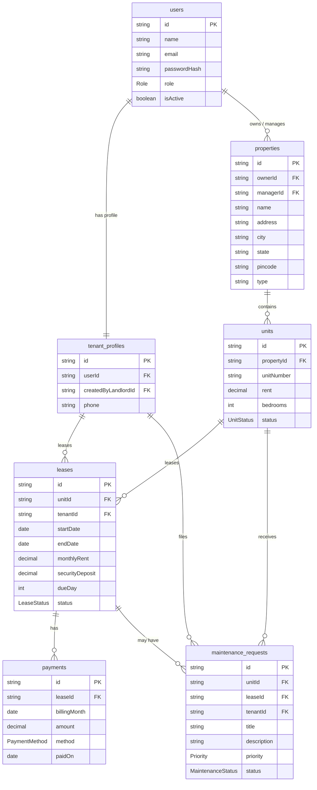

# RENTSETU RELATIONAL DATABASE ARCHITECTURE

## 1. Overview & Architectural Domains

The RentSetu relational database schema is structured into 4 interconnected domains comprising 7 core tables:

1. **Identity & Access**: `users`, `tenant_profiles`
2. **Property Portfolio**: `properties`, `units`
3. **Lease & Rentals**: `leases`, `payments`
4. **Maintenance & Service**: `maintenance_requests`

---

## 2. Mermaid Entity-Relationship Diagram

---

## 3. Domain Grouping

### Identity & Access
- `users`
- `tenant_profiles`

### Property Portfolio
- `properties`
- `units`

### Lease & Rentals
- `leases`
- `payments`

### Maintenance & Service
- `maintenance_requests`

---

## 4. Detailed Data Dictionary

### users
| Column | Type | Constraints | Description |
|---|---|---|---|
| id | string | PK | Unique user identifier |
| name | string | NOT NULL | Full name of the user |
| email | string | UNIQUE, NOT NULL | Email address used for login |
| passwordHash | string | NOT NULL | Hashed password for authentication |
| role | Role | NOT NULL | User role such as landlord or tenant |
| isActive | boolean | DEFAULT true | Whether the user account is active |

### tenant_profiles
| Column | Type | Constraints | Description |
|---|---|---|---|
| id | string | PK | Tenant profile identifier |
| userId | string | FK -> users.id | Link to the user account |
| createdByLandlordId | string | FK -> users.id | Landlord or manager who created the profile |
| phone | string | NULL | Tenant contact number |

### properties
| Column | Type | Constraints | Description |
|---|---|---|---|
| id | string | PK | Unique property identifier |
| ownerId | string | FK -> users.id | Property owner |
| managerId | string | FK -> users.id | Property manager assigned to this property |
| name | string | NOT NULL | Property or building name |
| address | string | NOT NULL | Street address |
| city | string | NOT NULL | City |
| state | string | NOT NULL | State |
| pincode | string | NOT NULL | Postal code |
| type | string | NOT NULL | Property category such as apartment or villa |

### units
| Column | Type | Constraints | Description |
|---|---|---|---|
| id | string | PK | Unit identifier |
| propertyId | string | FK -> properties.id | Parent property |
| unitNumber | string | NOT NULL | Unit number or suite name |
| rent | decimal | NOT NULL | Monthly rent |
| bedrooms | int | NOT NULL | Number of bedrooms |
| status | UnitStatus | NOT NULL | Unit availability status |

### leases
| Column | Type | Constraints | Description |
|---|---|---|---|
| id | string | PK | Lease identifier |
| unitId | string | FK -> units.id | Rented unit |
| tenantId | string | FK -> tenant_profiles.id | Tenant on this lease |
| startDate | date | NOT NULL | Lease start date |
| endDate | date | NOT NULL | Lease end date |
| monthlyRent | decimal | NOT NULL | Monthly rent for the lease |
| securityDeposit | decimal | NOT NULL | Security deposit charged |
| dueDay | int | NOT NULL | Rent due day of the month |
| status | LeaseStatus | NOT NULL | Lease state such as active or expired |

### payments
| Column | Type | Constraints | Description |
|---|---|---|---|
| id | string | PK | Payment identifier |
| leaseId | string | FK -> leases.id | Lease associated with the payment |
| billingMonth | date | NOT NULL | The month for which payment is made |
| amount | decimal | NOT NULL | Amount paid |
| method | PaymentMethod | NOT NULL | Payment method such as UPI or bank transfer |
| paidOn | date | NOT NULL | Payment date |

### maintenance_requests
| Column | Type | Constraints | Description |
|---|---|---|---|
| id | string | PK | Maintenance request identifier |
| unitId | string | FK -> units.id | Affected unit |
| leaseId | string | FK -> leases.id | Related lease |
| tenantId | string | FK -> tenant_profiles.id | Tenant who submitted the request |
| title | string | NOT NULL | Short request title |
| description | text | NOT NULL | Detailed issue description |
| priority | Priority | NOT NULL | Request urgency |
| status | MaintenanceStatus | NOT NULL | Current request stage |

---

## 5. Relationship Notes

- A user can own or manage many properties.
- Each property contains multiple units.
- A unit can be linked to multiple leases over time.
- A tenant profile can hold multiple leases.
- A lease may have multiple payment records.
- A unit or lease can generate multiple maintenance requests.

This structure supports the complete rent lifecycle: onboarding, property management, lease assignment, rent tracking, and maintenance resolution.
