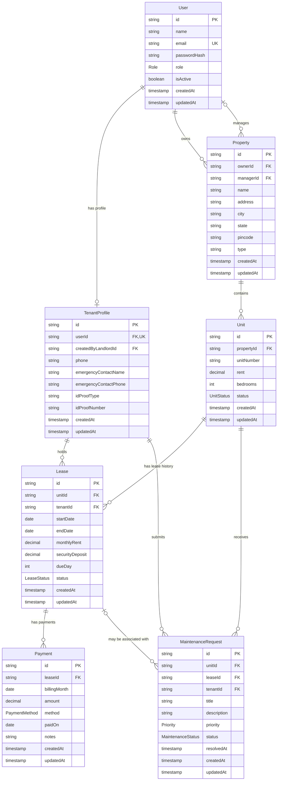

# RentSetu Entity-Relationship Diagram & Data Dictionary

## 1. Overview & Architectural Domains

The RentSetu relational schema contains seven tables across four functional domains:

1. **Identity & Access**: `User`, `TenantProfile`
2. **Property Portfolio**: `Property`, `Unit`
3. **Lease & Rentals**: `Lease`, `Payment`
4. **Maintenance & Service**: `MaintenanceRequest`

The SQL definition is maintained in [`03_schema.sql`](./03_schema.sql).

---

## 2. Mermaid Entity-Relationship Diagram

`Property.managerId` and `MaintenanceRequest.leaseId` are nullable. Mermaid ER syntax does not express nullability on individual attributes, so those optional columns are described here and in the data dictionary.

---

## 3. Domain Grouping

### Identity & Access
- `User`
- `TenantProfile`

### Property Portfolio
- `Property`
- `Unit`

### Lease & Rentals
- `Lease`
- `Payment`

### Maintenance & Service
- `MaintenanceRequest`

---

## 4. Detailed Data Dictionary

All IDs are UUID-formatted strings generated by Prisma and stored as `TEXT` in PostgreSQL. All timestamps use `TIMESTAMP(3)`.

### User
| Column | Type | Constraints | Description |
|---|---|---|---|
| id | TEXT | PK | User identifier |
| name | TEXT | NOT NULL | User's name |
| email | TEXT | UNIQUE, NOT NULL | Login email |
| passwordHash | TEXT | NOT NULL | Hashed password |
| role | Role | NOT NULL, DEFAULT TENANT | LANDLORD, MANAGER, or TENANT |
| isActive | BOOLEAN | NOT NULL, DEFAULT TRUE | Whether the account is active |
| createdAt | TIMESTAMP(3) | NOT NULL, DEFAULT CURRENT_TIMESTAMP | Creation time |
| updatedAt | TIMESTAMP(3) | NOT NULL | Last update time, maintained by Prisma |

### Property
| Column | Type | Constraints | Description |
|---|---|---|---|
| id | TEXT | PK | Property identifier |
| ownerId | TEXT | FK -> User.id, NOT NULL | Property owner |
| managerId | TEXT | FK -> User.id, NULL | Optional property manager |
| name | TEXT | NOT NULL | Property name |
| address | TEXT | NOT NULL | Street address |
| city | TEXT | NOT NULL | City |
| state | TEXT | NOT NULL | State |
| pincode | TEXT | NOT NULL | Postal code |
| type | TEXT | NOT NULL | Property type |
| createdAt | TIMESTAMP(3) | NOT NULL, DEFAULT CURRENT_TIMESTAMP | Creation time |
| updatedAt | TIMESTAMP(3) | NOT NULL | Last update time, maintained by Prisma |

### Unit
| Column | Type | Constraints | Description |
|---|---|---|---|
| id | TEXT | PK | Unit identifier |
| propertyId | TEXT | FK -> Property.id, NOT NULL | Parent property |
| unitNumber | TEXT | NOT NULL | Unit number |
| rent | DECIMAL(12,2) | NOT NULL | Listed rent |
| bedrooms | INTEGER | NOT NULL | Number of bedrooms |
| status | UnitStatus | NOT NULL, DEFAULT VACANT | VACANT or OCCUPIED |
| createdAt | TIMESTAMP(3) | NOT NULL, DEFAULT CURRENT_TIMESTAMP | Creation time |
| updatedAt | TIMESTAMP(3) | NOT NULL | Last update time, maintained by Prisma |

Unique constraint: `(propertyId, unitNumber)`.

### TenantProfile
| Column | Type | Constraints | Description |
|---|---|---|---|
| id | TEXT | PK | Tenant profile identifier |
| userId | TEXT | FK -> User.id, UNIQUE, NOT NULL | User associated with this tenant profile |
| createdByLandlordId | TEXT | FK -> User.id, NOT NULL | User who created the profile |
| phone | TEXT | NOT NULL | Tenant phone number |
| emergencyContactName | TEXT | NULL | Optional emergency contact name |
| emergencyContactPhone | TEXT | NULL | Optional emergency contact phone |
| idProofType | TEXT | NULL | Optional identification document type |
| idProofNumber | TEXT | NULL | Optional identification document number |
| createdAt | TIMESTAMP(3) | NOT NULL, DEFAULT CURRENT_TIMESTAMP | Creation time |
| updatedAt | TIMESTAMP(3) | NOT NULL | Last update time, maintained by Prisma |

### Lease
| Column | Type | Constraints | Description |
|---|---|---|---|
| id | TEXT | PK | Lease identifier |
| unitId | TEXT | FK -> Unit.id, NOT NULL | Leased unit |
| tenantId | TEXT | FK -> TenantProfile.id, NOT NULL | Tenant holding the lease |
| startDate | DATE | NOT NULL | Lease start date |
| endDate | DATE | NOT NULL | Lease end date |
| monthlyRent | DECIMAL(12,2) | NOT NULL | Contracted monthly rent |
| securityDeposit | DECIMAL(12,2) | NOT NULL | Security deposit |
| dueDay | INTEGER | NOT NULL, CHECK 1-28 | Monthly rent due day |
| status | LeaseStatus | NOT NULL, DEFAULT ACTIVE | ACTIVE, ENDED, or TERMINATED |
| createdAt | TIMESTAMP(3) | NOT NULL, DEFAULT CURRENT_TIMESTAMP | Creation time |
| updatedAt | TIMESTAMP(3) | NOT NULL | Last update time, maintained by Prisma |

Partial unique index: at most one ACTIVE lease per unit.

### Payment
| Column | Type | Constraints | Description |
|---|---|---|---|
| id | TEXT | PK | Payment identifier |
| leaseId | TEXT | FK -> Lease.id, NOT NULL | Associated lease |
| billingMonth | DATE | NOT NULL, CHECK day is 1 | First day of the billed month |
| amount | DECIMAL(12,2) | NOT NULL | Amount paid |
| method | PaymentMethod | NOT NULL | CASH, UPI, BANK_TRANSFER, CHEQUE, or CARD |
| paidOn | DATE | NOT NULL | Payment date |
| notes | TEXT | NULL | Optional payment notes |
| createdAt | TIMESTAMP(3) | NOT NULL, DEFAULT CURRENT_TIMESTAMP | Creation time |
| updatedAt | TIMESTAMP(3) | NOT NULL | Last update time, maintained by Prisma |

Unique constraint: `(leaseId, billingMonth)`.

### MaintenanceRequest
| Column | Type | Constraints | Description |
|---|---|---|---|
| id | TEXT | PK | Request identifier |
| unitId | TEXT | FK -> Unit.id, NOT NULL | Affected unit |
| leaseId | TEXT | FK -> Lease.id, NULL | Optional related lease |
| tenantId | TEXT | FK -> TenantProfile.id, NOT NULL | Tenant submitting the request |
| title | TEXT | NOT NULL | Short issue title |
| description | TEXT | NOT NULL | Issue details |
| priority | Priority | NOT NULL, DEFAULT MEDIUM | LOW, MEDIUM, HIGH, or URGENT |
| status | MaintenanceStatus | NOT NULL, DEFAULT OPEN | OPEN, IN_PROGRESS, RESOLVED, or CLOSED |
| resolvedAt | TIMESTAMP(3) | NULL | Resolution time, if resolved |
| createdAt | TIMESTAMP(3) | NOT NULL, DEFAULT CURRENT_TIMESTAMP | Creation time |
| updatedAt | TIMESTAMP(3) | NOT NULL | Last update time, maintained by Prisma |

---

## 5. Relationship Notes

- Each tenant profile belongs to one user; a user may have no tenant profile or one tenant profile.
- A user may own many properties; a property has one owner and may have one manager.
- Each property contains units, and each unit may have lease records over time.
- Each lease belongs to one tenant profile and may have multiple payments.
- A maintenance request belongs to a unit and tenant profile; it may optionally be linked to a lease.

The schema's foreign keys use `ON DELETE RESTRICT` and `ON UPDATE CASCADE`.
